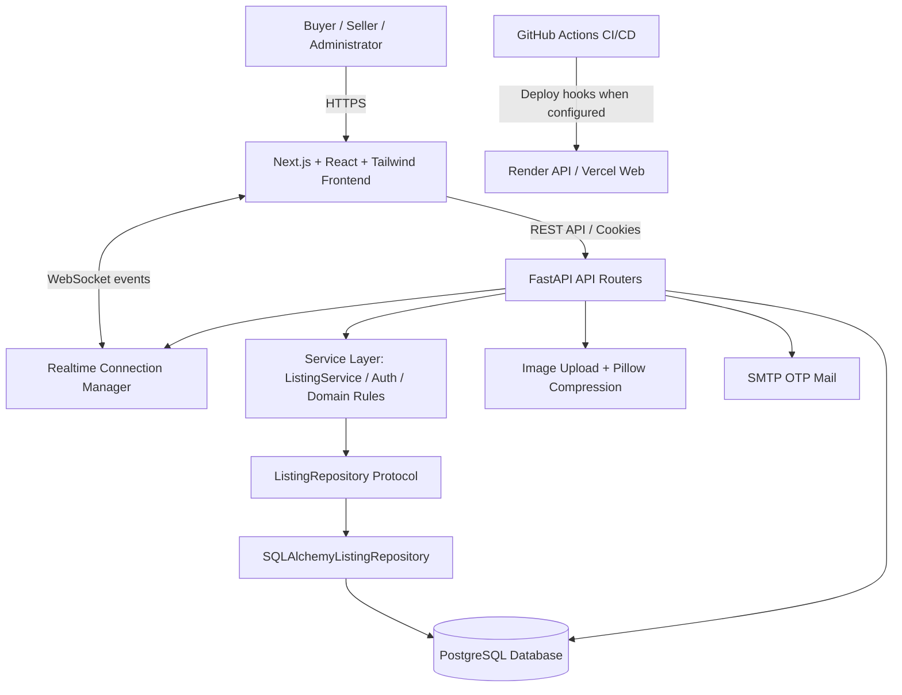
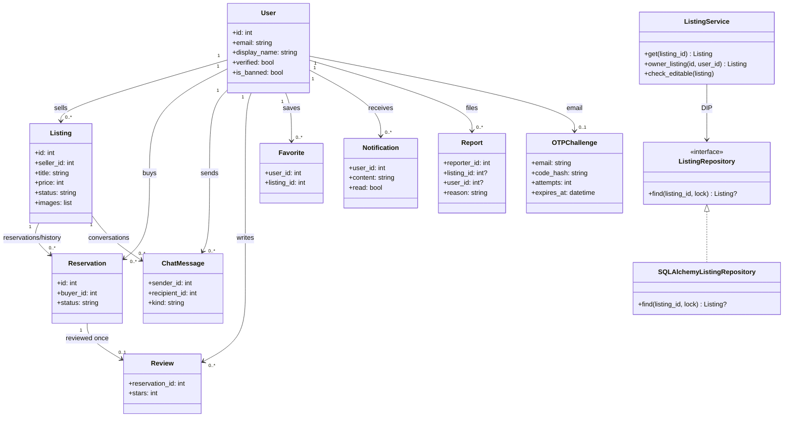

# KMITL Marketplace — System Architecture & OOP Design

> Academic MVP, not the official KMITL website. Proposed architecture based on `Original_Requirement.txt`.

## 1. System goals and scope

- Connect students/staff via institutional email OTP (FR-1), not an institutional SSO integration.
- List, search, reserve, sell, message, review and moderate second-hand items (FR-2 to FR-6).
- Distinguish demo-ready features from unfinished production integrations (see README).

## 2. Layered / Component Architecture



**Architecture decision**: Layered Monolith for an academic project: straightforward to test and deploy. API endpoints perform authentication/HTTP orchestration; `ListingService` owns listing-centric business rules; repository protocol separates storage details. Some modules still access SQLAlchemy directly; moving them to services/repositories is a documented refactoring opportunity.

## 3. Class Diagram



### Important domain invariants
- `Listing.status` = available → reserved → sold, or reserved → available via cancellation.
- A successful `Reservation` requires a non-owner buyer and an available listing; PostgreSQL `SELECT ... FOR UPDATE` protects reservation transitions under concurrency (not fully load-tested).
- A `Review` requires a completed reservation by the currently authenticated buyer; unique reservation constraint prevents duplication.
- Only the seller may modify/delete a listing, and only an active, configured administrator can moderate reports.

## 4. SOLID applied to code (what exists)

**S — Single Responsibility**: `ListingRepository` performs data retrieval; `ListingService` validates seller ownership and editing rules; FastAPI router converts requests/responses. `security.py` handles OTP digests and sessions.

**O — Open/Closed and D — Dependency Inversion**: `ListingService` accepts `ListingRepository` Protocol, so a mock or a different database implementation can be injected without editing domain logic. Reference `backend/app/repositories.py`, `backend/app/listing_service.py` and `backend/tests/test_advanced.py`.

**L — Liskov**: Repository implementations must honor `find()` semantics (item or None). The project currently supplies one implementation; tests use a substitute.

**I — Interface Segregation**: Small protocol exposes only `find()` rather than requiring dozens of unrelated DB methods.

**High cohesion**: responsibilities grouped into `routers/auth.py`, `routers/listings.py`, `routers/community.py`, and `listing_service.py`.

**Low coupling**: UI interacts with API, not SQLAlchemy; `ListingService` knows a protocol rather than concrete SQLAlchemy queries. Current direct DB access in other routers is a future refactoring target.

## 5. Two significant secure/clean code excerpts

**Ownership verification, actual implementation**:

```python
class ListingService:
    def owner_listing(self, listing_id: int, user_id: int) -> Listing:
        listing = self.get(listing_id, lock=True)
        if listing.seller_id != user_id:
            raise HTTPException(403, 'เฉพาะเจ้าของประกาศเท่านั้น')
        return listing
```

**Repository substitution, actual implementation**:

```python
class ListingRepository(Protocol):
    def find(self, listing_id: int, *, lock: bool = False) -> Listing | None: ...

class SQLAlchemyListingRepository:
    def find(self, listing_id: int, *, lock: bool = False) -> Listing | None:
        query = select(Listing).where(Listing.id == listing_id)
        if lock:
            query = query.with_for_update()
        return self.session.scalar(query)
```

## 6. Refactoring opportunities

1. Move `community.py` and reservation state transitions into dedicated services with repository contracts.
2. Use Alembic migrations rather than `Base.metadata.create_all` in production.
3. Replace in-memory WebSocket fanout with Redis pub/sub and add authorized connection rooms.
4. Add transaction-level audit logs, audit-admin actions and optimistic conflict UI.
5. Add moderation queue, real cloud image storage, FCM and map integration.
6. Introduce structured logging, metrics, SLO measurement, test factories and integration tests with Postgres.

## 7. Problems encountered/design tradeoffs (design analysis, not claimed team history)

- Reserved/sold status needs transaction boundaries; row lock is used for Postgres, while SQLite tests only validate functional flow.
- OTP-only authentication means no password storage; NFR password hashing is **not applicable** unless password login is introduced. OTP challenge is HMAC-hashed instead.
- Security tradeoff: secure HttpOnly cookies, explicit `Origin` checks on writes, CORS allowlist. Deployment domains must be configured correctly.
