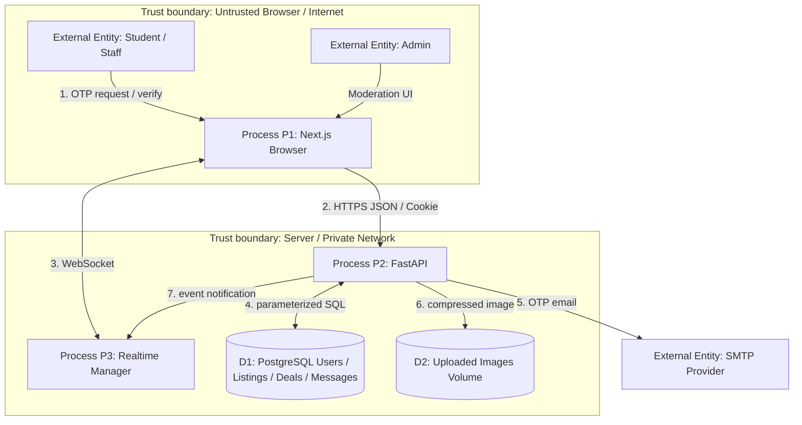
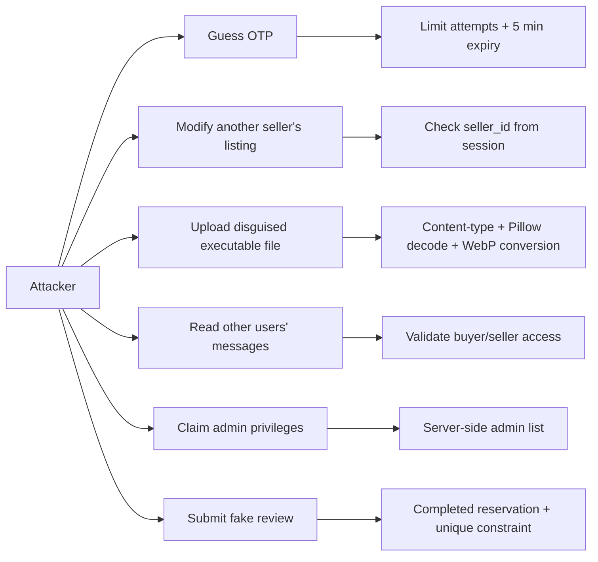

# Threat Analysis — DFD, Misuse Cases, Assets, Security Requirements

## 1. DFD with trust boundaries (Level 1)

**Trust boundary crossing**: Browser→API (authentication/session/CSRF); API→DB (injection/access controls); API→SMTP (secret configuration); User-uploaded image→image store (malicious file); browser→WebSocket (origin and cookie checks).

## 2. Asset list

| ID | Asset | Value | Security properties |
|---|---|---|---|
| A1 | Institutional user email, phone, LINE ID | High | Confidentiality, consent, integrity |
| A2 | Session cookie and secret key | Critical | Confidentiality, authenticity |
| A3 | OTP HMAC, expiry and attempt records | High | Integrity, short lifetime |
| A4 | Listings, price, ownership and status | High | Integrity, availability |
| A5 | Buyer/seller message content | High | Confidentiality, integrity |
| A6 | Reviews and reservation records | Medium | Integrity, non-duplication |
| A7 | Product photos | Medium | Integrity, malware-resistant upload |
| A8 | Admin roles, moderation decisions | Critical | Authorization, auditability |
| A9 | PostgreSQL credentials and CI/CD hooks | Critical | Confidentiality |

## 3. STRIDE risk analysis

| STRIDE | Threat | Attack surface | Mitigation in MVP / gap |
|---|---|---|---|
| S Spoofing | Attacker attempts to log in as student | OTP endpoint | `@kmitl.ac.th` restriction, 6-digit OTP, expiry, max 5 attempts and resend delay; IP throttling outstanding |
| T Tampering | Buyer edits seller's product | PATCH `/listings/{id}` | Server-side owner check + repository-backed service |
| R Repudiation | User denies changing an order | Reservation/moderation | Status tracked, but immutable audit log not yet implemented |
| I Disclosure | User reads another buyer's chats | GET messages | `validate_partner()` enforces seller/buyer conversation membership |
| D DoS | OTP spam / upload bomb | Request OTP / images | Resend delay; 5 MB and pixel limits; global rate limiting outstanding |
| E Elevation | Normal user accesses admin API | `/admin/*` | Server checks configured admin email, never trusts client flags |
| T Tampering | Price/SQL injection | Query and UPDATE | ORM parameterization and Pydantic validation |
| S/ I | CSRF/session theft | Browser cookies | HttpOnly, Secure production cookies, allowlisted Origin, HTTPS at hosting layer; deployment verification pending |

## 4. Misuse cases (attacker perspective)

Misuse case example UC-M2: attacker logs in using own institutional account → attempts `PATCH /listings/42` belonging to another seller → backend rejects with HTTP 403 → evidence: `test_owner_and_reservation_and_review()`.

## 5. Security requirements derived from threats

- SR-01: Only valid institutional email accounts can complete OTP verification.
- SR-02: OTP expires within 5 minutes and locks after at most 5 failed attempts.
- SR-03: All product write operations enforce server-side object ownership.
- SR-04: Review permitted only for completed reservations, once per reservation.
- SR-05: Chats restricted to the relevant buyer and seller.
- SR-06: Uploads are checked, limited, decoded and re-encoded.
- SR-07: Cookie writes reject untrusted `Origin` requests.
- SR-08: Admin permissions are checked on every request against configured email allowlist.
- SR-09: Production requires TLS, PostgreSQL, strong secrets, persistent storage and SMTP configuration; hosted deployment must prove those controls.
- SR-10: Global request/IP limits, Redis fanout, independent logging and penetration testing are required before real public use (not yet complete).

## 6. Recommended security validation

Test direct unauthorized API calls, expired/invalid OTP, wrong buyer review, forged Origin, malicious PNG payload, banned user, duplicate reservation, and duplicate review. Capture pytest output and API response screenshots as assessment evidence. No vulnerability scan or penetration-test claim is made without actual results.
